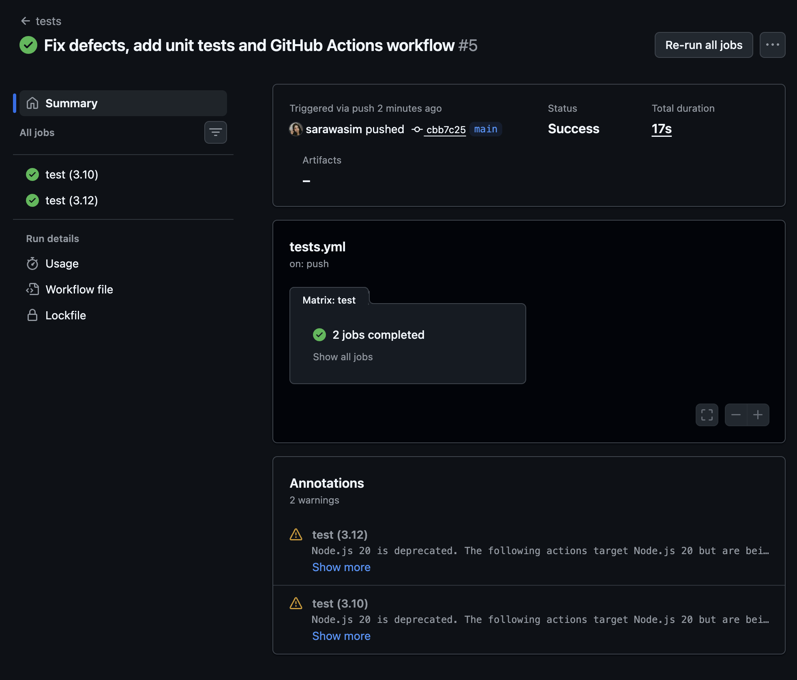

# Defects found and fixed

| #   | Where                                      | What could go wrong                                                                                                    | Fix                                                                                                                                 | Test(s)                                                                                                       |
| --- | ------------------------------------------ | ---------------------------------------------------------------------------------------------------------------------- | ----------------------------------------------------------------------------------------------------------------------------------- | ------------------------------------------------------------------------------------------------------------- |
| 1   | `cart.add_item`                            | The stock check ignored what was already in the cart. Adding 5 laptops twice put 10 in the cart with only 5 in stock.  | Checks `already_in_cart + quantity` against stock and raises `CartError`.                                                           | `test_combined_quantity_cannot_exceed_stock`                                                                  |
| 2   | `models.py`, `cart.subtotal`               | Money used `float`. A subtotal that prints `59.92` was not equal to `Decimal('59.92')`.                                | Money uses `Decimal`, rounded to cents with `ROUND_HALF_UP` through `to_money()`.                                                   | `test_subtotal_is_exact_to_the_cent`                                                                          |
| 3   | `cart.apply_discount` / `total`            | The discounted total was saved once. Adding 5 more mice after WELCOME10 still charged **$53.91 for $209.65** of goods. | Only the discount code is stored, and `total()` recalculates from the current subtotal.                                             | `test_total_updates_when_cart_changes_after_discount`                                                         |
| 4   | `cart.apply_discount` (SAVE15)             | $15 off a $9.99 cart gave a total of **-$5.01**.                                                                       | The fixed discount is capped at the subtotal.                                                                                       | `test_fixed_discount_never_goes_negative`                                                                     |
| 5   | `cart.load`                                | `load()` added to the existing cart, so loading twice doubled every quantity.                                          | `load()` resets the cart first.                                                                                                     | `test_loading_twice_does_not_double_quantities`                                                               |
| 6   | `repository.get_product`, `get_saved_cart` | f-string SQL allowed **SQL injection**: `get_product("x' OR '1'='1")` returned a laptop.                               | Parameterised queries (`?`).                                                                                                        | `test_get_product_is_not_sql_injectable`                                                                      |
| 7   | `checkout`                                 | Stock was taken before payment and never returned, and the cart was emptied even when payment was declined or failed.  | Stock is reserved with a `pending` order in one transaction. If payment isn't approved, the stock is put back and the cart is kept. | `test_declined_payment_restores_stock_and_keeps_cart`, `test_gateway_exception_is_handled_and_stock_restored` |
| 8   | `checkout` (`request_id`)                  | Retrying the same request charged the customer twice.                                                                  | `request_id` is required and `UNIQUE`. A repeated ID returns the original order without charging.                                   | `test_repeated_request_id_charges_only_once`                                                                  |

## Assumptions

- **Rounding:** a percentage discount rounds the discounted price half-up to the cent.
- **Repeated `request_id`:** returns the original result. A new attempt needs a new `request_id`.

## Test results

    $ python3 -m pytest -q
    .......................................                                  [100%]
    20 passed

## CI

Successful GitHub Actions run: https://github.com/sarawasim/order-processing-lab/actions/runs/45116822105

